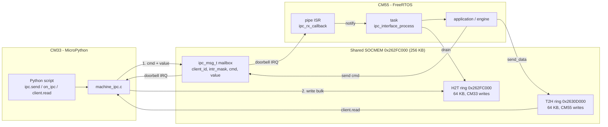
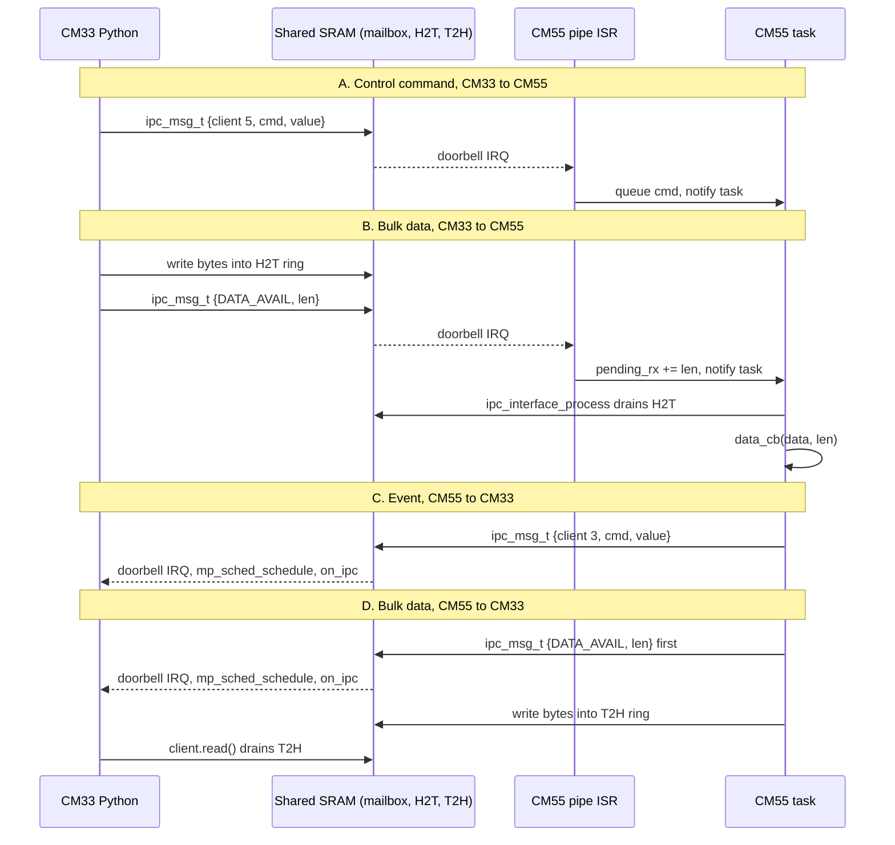

# IPC Transport (CM55 side)

IPC transport between the CM33 (MicroPython) and CM55 cores of PSOC™ Edge. It
implements the `transport_interface_t` vtable ([transport.h](../../includes/transport.h)), and can also be used directly by any CM55 application.

Two kinds of traffic share one IPC pipe:

| Traffic | Carries | Mechanism |
| --- | --- | --- |
| **Command / value** | Small control messages: a 1-byte `cmd` and a 32-bit `value` | `ipc_msg_t` in shared SRAM, announced by an IPC interrupt |
| **Bulk data** | Byte streams (audio, tensors, results) | Two 64 KB lock-free rings in shared SRAM, announced by a `DATA_AVAIL(len)` doorbell |

## IDs and constants

| Item | CM33 | CM55 |
| --- | --- | --- |
| Pipe endpoint address | 1 | 2 |
| Default client ID | 3 | 5 |
| Max clients per endpoint | 8 | 8 |

| Command | Code | Meaning |
| --- | --- | --- |
| `IPC_CMD_DATA_AVAIL` | 0x84 | Doorbell: `value` bytes are in the sender's ring. Reserved by the transport. |
| `IPC_CMD_INIT` / `START` / `STOP` / `STATUS` | 0x81 / 0x82 / 0x83 / 0x41 | Generic application commands. |

Application commands such as the TFLM ones (0x90 to 0x95, events 0xB0 to 0xB4,
0xE0) are defined by the layer above, see [tflm_engine.h](../../engine/tflm/tflm_engine.h).

## How it works

### Overview



Each direction has an owner that initializes its ring: CM33 initializes H2T
(`IPC.init()`), CM55 initializes T2H (`ipc_interface_init()`). Initialize IPC on
CM33 **before** booting CM55.

### Command / value transfer

A control message is an `ipc_msg_t { client_id, intr_mask, cmd, value }` placed in
a buffer in shared SRAM (`CY_SECTION_SHAREDMEM`). The pipe passes a pointer to
it and raises an interrupt on the other core, which is the doorbell. Messages
are small, one is in flight at a time, and the sender retries while the channel
is busy (up to 100 times, 1 ms apart).

CM33 to CM55:

1. Python `ipc.send(cmd, value, client_id)` fills the mailbox with the target
   client ID and calls `Cy_IPC_Pipe_SendMessage(EP2 <- EP1)`.
2. CM55 pipe ISR calls `ipc_rx_callback`, which looks up the callback registered
   for that client ID and calls it. For the default client it calls the callback
   set by `ipc_interface_register_receive_cb`.
3. The callback runs in interrupt context.

CM55 to CM33:

1. `ipc_interface_send(cmd, value)` (client 3 on CM33) or
   `ipc_interface_send_command(cm33_client_id, cmd, value)` fills the mailbox and
   sends it to EP1.
2. CM33 ISR `cm33_msg_callback` stores `cmd` and `value` in the client object
   (`client.cmd`, `client.value`) and schedules the Python callback from the
   MicroPython scheduler.

The two send functions use separate shared buffers (`s_tx_msg` and `s_cmd_tx`).
They are not reentrant, so serialize calls to each from one task.

### Bulk data transfer (shared memory)

Large payloads go through a **ring buffer
in shared SRAM** that both cores can read and write, and the message only says
how many bytes were added. The ring buffers are 
**Single producer, single consumer.** The producer only writes `head`, the
  consumer only writes `tail`. Both are free-running 32-bit byte counters, so no
  lock is needed.

**CM33 to CM55** :

1. CM33 writes the bytes into the H2T ring first, then sends a
   `DATA_AVAIL(len)` message. If the ring is full it keeps writing as CM55
   drains (bounded wait, then `OSError`).
2. The CM55 ISR only adds `len` to `s_pending_rx_length` and notifies the task.
   Doorbells can coalesce, so lengths are summed, not overwritten.
3. The task calls `ipc_interface_process()`, which reads that many bytes from the
   ring and hands them to the data callback in chunks of up to 64 KB
   (`IPC_H2T_CHUNK`). This runs in task context, never in the ISR.

**CM55 to CM33** :

1. `ipc_interface_send_data(buf, len)` sends `DATA_AVAIL(len)` **first**, then
   writes the bytes into the T2H ring, so CM33 can drain while CM55 is still
   writing. If the ring is full it waits (bounded) for CM33 to drain.
2. The CM33 ISR stores `len` in `client.value` and schedules the Python callback.
   The ISR does not read the ring, since MicroPython cannot allocate there.
3. The Python callback calls `client.read()`, which drains from the
   T2H ring into a reused `memoryview`. Copy it out and call `read()` again until `client.value` bytes have been
   read.

Payloads larger than a ring are fine, because both sides apply back-pressure
instead of dropping data. Bulk transfers wait a bounded time (about 100 ms
without progress) before giving up with a partial count or an error.

### Diagram

Four paths: control CM33 to CM55 (A), bulk CM33 to CM55 (B), event CM55 to CM33
(C), bulk CM55 to CM33 (D).



## How to use it

### CM55 side (C)

```c
#include "ipc.h"
#include "ipc_communication.h"

static void on_cmd(uint8_t cmd, uint32_t value)   /* ISR context: queue and notify only */
{
    /* push {cmd, value} to a queue, then vTaskNotifyGiveFromISR(task) */
}

static void on_data(const uint8_t *data, size_t len)  /* task context */
{
    /* consume the bytes; the buffer is only valid during the call */
}

int main(void)
{
    cybsp_init();
    __enable_irq();

    ipc_interface_init();                              /* pipe + T2H ring */
    ipc_interface_register_receive_cb(on_cmd);         /* client 5 commands */
    ipc_interface_set_data_cb(on_data);                /* bulk sink (H2T) */

    xTaskCreate(worker, "worker", 2048, NULL, CY_RTOS_PRIORITY_NORMAL, &worker_hdl);
    ipc_interface_set_process_task(worker_hdl);        /* wakes on DATA_AVAIL */
    vTaskStartScheduler();
}

static void worker(void *arg)
{
    for (;;) {
        ulTaskNotifyTake(pdTRUE, portMAX_DELAY);
        ipc_interface_process();                       /* drains H2T into on_data() */
        /* ...handle queued commands... */
        /* reply: */
        ipc_interface_send(0xB1, 0);                   /* event to CM33 client 3 */
        ipc_interface_send_data(result, result_len);   /* bulk to CM33 */
    }
}
```

### CM33 side (MicroPython)

```python
from machine import IPC

CM33_CLIENT, CM55_CLIENT, EP_ID, EP_ADDR = 3, 5, 1, 1
result = {"evt": None, "val": 0, "data": None}

def on_ipc(client):
    if client.cmd == IPC.CMD_DATA_AVAIL:      # bulk reply, client.value = length
        result["data"] = bytes(client.read()) # copy: the memoryview is reused
    else:                                     # control event
        result["evt"], result["val"] = client.cmd, client.value

ipc = IPC(src_core=IPC.CM33, target_core=IPC.CM55)
ipc.init()                                    # pipe + H2T ring, BEFORE booting CM55
ipc.register_client(CM33_CLIENT, on_ipc, EP_ID, EP_ADDR)
ipc.enable_core(IPC.CM55)

ipc.send(0x90, 0, CM55_CLIENT)                # command + value
ipc.send(IPC.CMD_DATA_AVAIL, b"\x01\x02", CM55_CLIENT)   # bulk (any buffer object)
```

- `ipc.send(cmd, int, client)` sends a command/value message.
- `ipc.send(IPC.CMD_DATA_AVAIL, buffer, client)` (bytes, bytearray or
  memoryview) writes to the H2T ring, then rings the doorbell. Large payloads
  can be sent in chunks: CM55 accumulates every chunk.
- Callbacks run in the MicroPython scheduler, not in the ISR, so they may
  allocate, but keep them short and copy data out of the `read()` memoryview.

## Notes and limitations

- Hardware: one CM33 and one CM55 endpoint, up to 8 clients per endpoint.
- A command is lost if the CM55 command queue fills (the TFLM engine queue holds
  8). Do not send commands faster than CM55 handles them.
- CM55 keeps running across a CM33 soft reset. Applications built on this
  transport must tolerate a restarted CM33 (for example the TFLM engine rejects a
  second `MODEL_LOAD`, so hard-reset the board between runs).
- `ipc_interface_send()` waits 2 ms before every send, which limits the
  control-message rate from CM55.

## License

MIT © 2026 Infineon Technologies AG.
